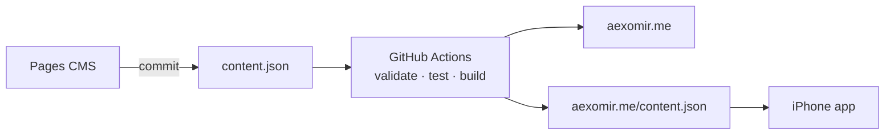

# aexomir.me

My portfolio: a static site built from one JSON file, with no framework and no dependencies. The same file also powers my [iPhone app](https://github.com/aexomir/portfolio-app).

## How it fits together



- **One source of truth.** Profile, projects, case studies, experience and links all live in [`content.json`](content.json). I edit it in [Pages CMS](https://app.pagescms.org) (forms in [`.pages.yml`](.pages.yml)). Each save is a commit, and the site deploys in about a minute.
- **Bad content never ships.** [`scripts/build.mjs`](scripts/build.mjs) validates everything before rendering. If a check fails, the deploy stops and the live site keeps its last good version.
- **Static pages.** The build renders the home page, `/projects/`, a page for each case study, `/experience/`, `/contact/` and a 404 into [`layout.html`](layout.html). Each page ends with one "Next" link, so the site reads front to back.

## Details worth knowing

- **Page transitions.** These are cross-document view transitions: the page crossfades, the header stays put, and a project's title moves between the list and its case study. Browsers without support navigate normally, and reduced-motion settings turn the transitions off.
- **No layout shift.** Geist is self-hosted and preloaded. Image sizes are read from the files at build time. The name's hover effect reserves each letter's widest width, so it never reflows the line.
- **Remote control for the app.** The `app` section of `content.json` drives a maintenance banner, an update notice and feature switches. Buttons in Pages CMS publish an over-the-air update or build for TestFlight (setup is in the [app README](https://github.com/aexomir/portfolio-app#pipeline-setup-one-time)).

## Run it

```bash
node --test scripts/build.test.mjs
node scripts/build.mjs
python3 -m http.server 4173 -d _site    # http://localhost:4173
```

Pages use root paths, so open them through a server rather than as files. Geist is under the SIL Open Font License ([`fonts/OFL.txt`](fonts/OFL.txt)).
